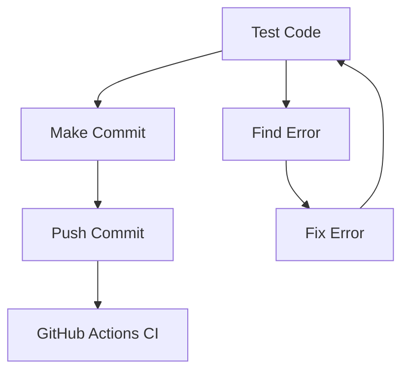

# Markdown Syntax
___
* [Headers](#headers)
* [Text formatting](#text-formatting)
    * [Fat](#fat)
    * [Cursive](#cursive)
    * [Fat and Cursive](#fat-and-cursive)
    * [Line through](#line-through)
    * [Escaping](#escaping)
    * [Keyboard keys](#keyboard-keys)
    * [Line Breaks](#line-breaks)
* [Lists](#lists)
    * [Unordered List](#unordered-list)
    * [Ordered List](#ordered-list)
* [Quotes](#quotes)
    * [Singleline quote](#singleline-quote)
    * [Multiline quote](#multiline-quote)
    * [Nested quote](#nested-quote)
* [Splitting lines](#splitting-lines)
* [Links](#links)
    * [Easy link](#easy-link)
    * [Automatic link](#automatic-link)
    * [Email link](#email-link)
    * [In-page link](#in-page-link)
* [Pictures](#pictures)
    * [Picture in file](#picture-in-file)
        * [Website](#website)
        * [Downloaded file](#downloaded-file)
    * [Picture with link](#picture-with-link)
        * [Website](#website-1)
        * [Downloaded File](#downloaded-file-1)
* [Code](#code)
    * [Inline code](#inline-code)
    * [Tab codeblock](#tab-codeblock)
    * [No tab codeblock](#no-tab-codeblock)
    * [Codeblock with highlighting](#codeblock-with-highlighting)
    * [Diff code](#diff-code)
    * [Diagrams](#diagrams)
* [Table](#table)
* [Math formulas(LaTeX)](#math-formulaslatex)
    * [Greek alphabet](#greek-alphabet)
    * [Arithmatic](#atrithmatic)
        * [Exponents](#exponents)
        * [Subscript](#subscript)
        * [Fractions](#fractions)
        * [Square Root](#square-root)
        * [Higher Root](#higher-root)
        * [Multiplication](#multiplication)
            * [Dot](#dot)
            * [Cross](#cross)
        * [Dividing](#dividing)
    * [Operators](#operators)
        * [Sum](#sum)
        * [Product](#product)
        * [Integral](#integral)
        * [Multi-Integral](#multi-integral)
        * [Ring-Integral](#ring-integral)
        * [Limitation](#limitation)
    * [Matrix and Vector](#matrix-and-vector)
        * [No Braces Matrix](#no-braces-matrix)
        * [Round Braces Matrix](#round-braces-matrix)
        * [Square Braces Matrix](#square-braces-matrix)
        * [Determinate](#determinate)
        * [Vector Arrow](#vector-arrow)
        * [Fat Vector](#fat-vector)
        * [Vectors with Dots](#vectors-with-dots)
        * [Vectors with Lines](#vectors-with-lines)
    * [Math Relations and Symbols](#math-relations-and-symbols)
        * [Infinity](#infinity)
        * [Smaller Equals](#smaller-equals)
        * [Bigger Equals](#bigger-equals)
        * [Not Equals](#not-equals)
        * [Approximately](#approximately)
        * [Empty quantity](#empty-quantity)
        * [Implies](#implies)
        * [Equivalent](#equivalent)
        * [Forall](#forall)
        * [Exists](#exists)
        * [Nabla](#nabla)
        * [Partial](#partial)
    * [Scaling Braces](#scaling-braces)
    * [Align](#align)
    * [Text](#text)
    * [Cases](#cases)
* [Github](#github)
    * [Task lists](#task-lists)
    * [Alerts](#alerts)
    * [Emojis](#emojis)
    * [Autolinks](#autolinks)
    * [Footnotes](#footnotes)
## Headers
# H1
Also H1
===
## H2
Also H2
---
### H3
#### H4
##### H5
###### H6

## Text formatting

### Fat:

**fat**

__also fat__

### Cursive:

*cursive*

_also cursive_

### Fat and Cursive:

***fat and cursive***

___also fat and cursive___

### Line through:

~~line through~~

### Escaping:

\*\*Not fat text\*\*

\*Not cursive\*

\~\~No line through\~\~

### Keyboard keys

<kbd>Ctrl</kbd> + <kbd>C</kbd>

### Line breaks

1:

test

2:  
idk

## Lists

### Unordered list:

- 1
* 2
    * Underpoint of 2
+ 3

### Ordered list:

1. point 1
2. point 2
3. point 3
1. this is also possible

## Quotes

### Singleline quote:

> This is a singleline quote

### Multiline quote:

> Line 1 of the quote
> Line 2 of the quote

### Nested quote:

> Main quote
>> Nested quote

## Splitting lines

**1**

---
**2**

***
**3**

___

## Links

### Easy link:

[Text to show](Link "Text that is shown when hovering over it")

**For Example:**

[Google](https://www.google.com "Go to google")

### Automatic link:

<Link>

**For Example:**

<https://www.google.com>

### Email link:

<email@of-someone.com>

**For Example:**

<contact@example.com>

### In-page link

[jump to link](#link)

**For Example:**

#### Idk

[jump to idk](#idk)

## Pictures

### Picture in file:


**For Example:**

#### Website:


#### Downloaded file:


### Picture with link:

[](https://target-site.com)

**For Example:**

#### Website:

[](https://en.wikipedia.org/wiki/Markdown)

#### Downloaded file:

[](https://en.wikipedia.org/wiki/Dog)

## Code

### Inline code:

`Code`

### Tab codeblock:

    Code


### No tab codeblock:
```
Code
```
### Codeblock with highlighting:

```python
name = "Markdown"
print(f"Hello this is highlighted text in {name}")
```

### Diff code:

```diff
Unchanged line
- removed line
+ added line
```

## Diagrams



## Table:

| 1 (Left) | 2 (center) | 3 (right) |
| :--- | :---: | ---: |
| Content 1 | Content 2 | Content 3 |

## Math formulas(LaTeX)

[Skip to next](#diagrams)

### Greek alphabet:

$$
\Alpha
\alpha
\Beta
\beta
\Gamma
\gamma
\Delta
\delta
\Epsilon
\epsilon
\Zeta
\zeta
\Eta
\eta
\Theta
\theta
\Iota
\iota
\Kappa
\kappa
\Lambda
\lambda
\Mu
\mu
\Nu
\nu
\Xi
\xi
\Pi
\pi
\Rho
\rho
\Sigma
\sigma
\Tau
\tau
\Phi
\phi
\Chi
\chi
\Psi
\psi
\Omega
\omega
$$

### Atrithmatic:

#### Exponents:

$$
num^{exponent}
$$

**For Example:**

$$
\pi^{2}
$$

#### Subscript:

$$
num_{subscript}
$$

**For Example:**

$$
H_2O
$$

#### Fractions:

$$
\frac{numerator}{denominator}
$$

**For Example:**

$$
\frac{1}{3}
$$

#### Square Root:

$$
\sqrt{num}
$$

**For Example:**

$$
\sqrt{4}
$$

#### Higher Root:

$$
\sqrt[root-num]{num}
$$

**For Example:**

$$
\sqrt[3]{27}
$$

#### Multiplication:

##### Dot:

$$
num1 \cdot num2
$$

**For Example:**

$$
5 \cdot 3
$$

##### Cross:

$$
num1 \times num2
$$

**For Example:**

$$
5 \times 3
$$

#### Dividing:

$$
num1 \div num2
$$

**For Example:**

$$
6 \div 2
$$

### Operators:

#### Sum:

$$
\sum_{down-num}^{up-num} right-num
$$

**For Example:**

$$
\sum_{i=1}^{n} i
$$

#### Product:

$$
\prod_{down-num}^{up-num} right-num
$$

**For Example:**

$$
\prod_{i=1}^{n} x_1
$$

#### Integral:

$$
\int_{down-num}^{up-num} right-formula
$$

**For Example:**

$$
\int_{a}^{b} x^2\,dx
$$

#### Multi-Integral:

$$
\iint_{down-num}^{up-num} rigth-num
$$

**For Example:**

$$
\iint_v \,dv
$$

#### Ring-Integral:

$$
\oint_{down-num}^{up-num} right-num
$$

**For Example:**

$$
\oint_C \vec{E} \cdot d\vec{s}
$$

#### Limitation:

$$
\lim_{num \to limitation}
$$

**For Example:**

$$
\lim_{x \to \infty} f(x)
$$

### Matrix and Vector:

#### No Braces Matrix:

$$
\begin{matrix} matrix \\ line 2\end{matrix}
$$

**For Example:**

$$
\begin{matrix} a & b \\ c & d \end{matrix}
$$

#### Round Braces Matrix:

$$
\begin{pmatrix} matrix \\ line 2 \end{pmatrix}
$$

**For Example:**

$$
\begin{pmatrix} a & b \\ c & d \end{pmatrix}
$$

#### Square Braces Matrix

$$
\begin{bmatrix} matrix \\ line 2 \end{bmatrix}
$$

**For Example:**

$$
\begin{bmatrix} a & b \\ b & c \end{bmatrix}
$$

#### Determinate:

$$
\begin{vmatrix} matrix \\ line 2 \end{vmatrix}
$$

**For Example:**

$$
\begin{vmatrix} a & b \\ b & c \end{vmatrix}
$$

#### Vector Arrow:

$$
\vec{Number} 
\overrightarrow{num}
$$

**For Example:**

$$
\vec{a}
\overrightarrow{AB}
$$

#### Fat Vector:

$$
\mathbf{num}
$$

**For Example:**

$$
\mathbf{x}
$$

#### Vectors with Dots:

$$
\dot{num} \\
\ddot{num}
$$

**For Example:**

$$
\dot{x} \\
\ddot{x}
$$

#### Vectors with Lines:

$$
\bar{num} \\
\overline{num}
$$

**For Example:**

$$
\bar{x} \\
\overline{x}
$$

### Math Relations and Symbols:

#### Infinity:

$$
\infty
$$

#### Smaller Equals:

$$
\le \\
\leq
$$

#### Bigger Equals:

$$
\ge \\
\geq
$$

#### Not Equals:

$$
\neq
$$

#### Approximately:

$$
\approx
$$

#### Empty quantity:

$$
\propto
$$

#### Implies:

$$
\implies \\
\rightarrow
$$

#### Equivalent:

$$
\iff \\
\leftrightarrow
$$

#### Forall:

$$
\forall
$$

#### Exists:

$$
\exists
$$

#### Nabla:

$$
\nabla
$$

#### Partial:

$$
\partial
$$

### Scaling Braces.

$$
\left(someting \right)
$$

**For Example:**

$$
\left( \frac{a}{b}\right) \\
\left[ \sum_{i=1}^n x_i \right]
$$

### Align:

$$
\begin{align}
step-1 &= step-1-equals \\
       &= step-2-equals
\end{align}
$$

**For Example:**

$$
\begin{align}
 f(x) &= (x + 2)^2 \\
      &= x^2 + 4x + 4
\end{align}
$$

### Text:

$$
\text{This is how to write Text in Math}
$$

### Cases:

$$
begin = 
\begin{cases}
    line-1 \\
    line-2
\end{cases}
$$
$$

|x| =
\begin{cases}
    x & \text{if } x \geq 0 \\
   -x & \text{if } x < 0
\end{cases}
$$

# GitHub

## Task lists:

- [x] Done point
- [ ] Not done point

## Alerts

> [!NOTE]
> Information

> [!TIP]
> Tip

> [!IMPORTANT]
> Important thing

> [!WARNING]
> Warning

> [!CAUTION]
> Caution thing

## Emojis

:rocket: :warning: :sparkles:

## Autolinks

#42  
^  
|  
Links to Pull Request or Issue 42

@username  
^  
|  
Links to Usernames account

9f7a1c4
^  
|  
Links to commit hash 9f7a1c4

## Footnotes

Text with its footnote[^1]

[^1]: Its footnote at the end of the file